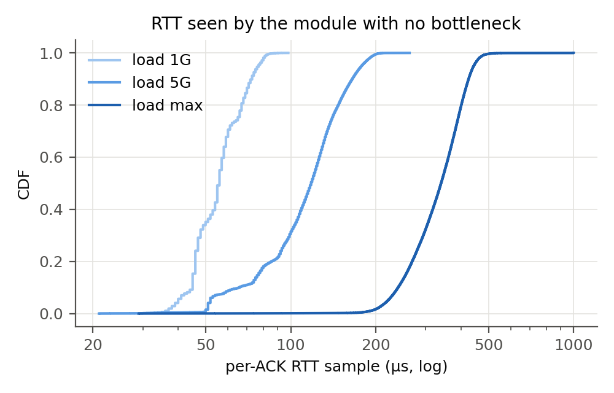
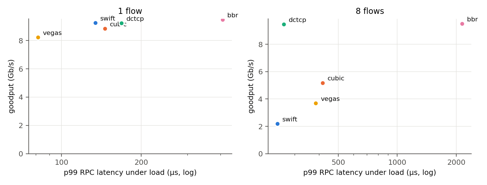
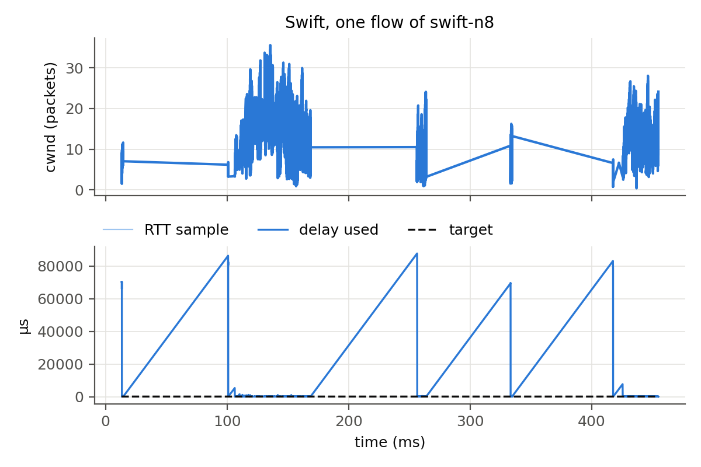
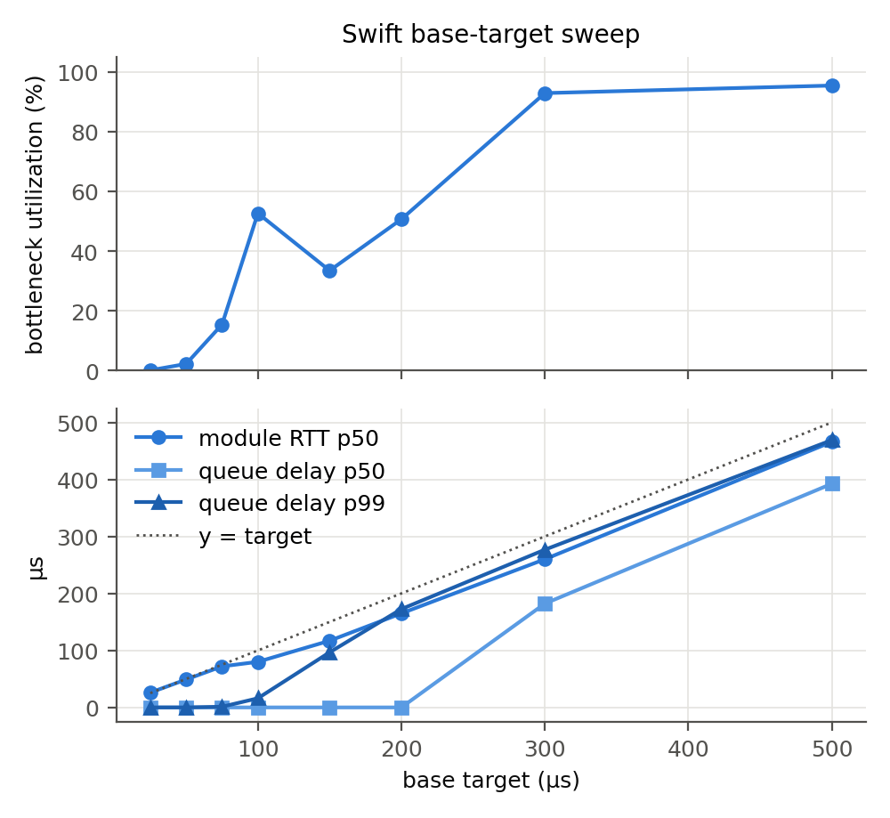
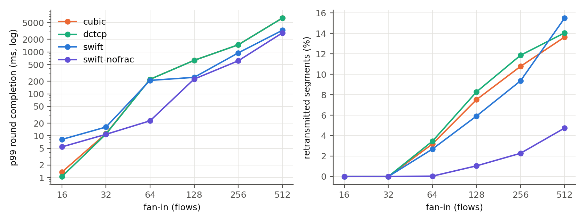
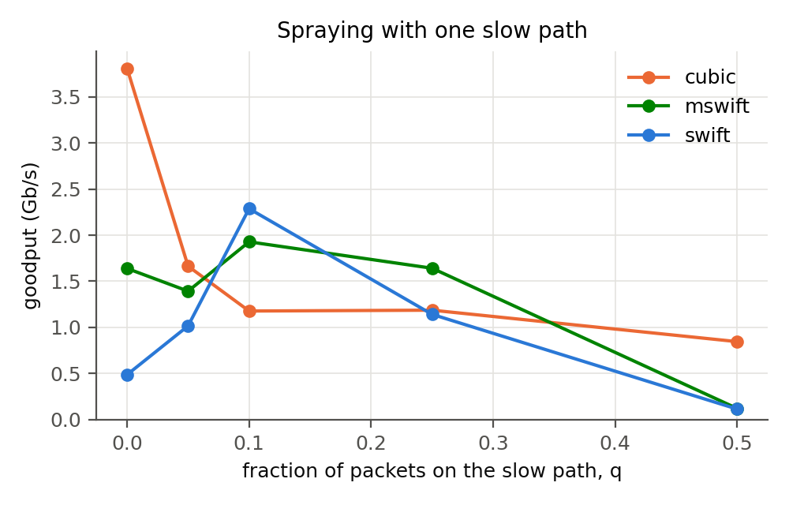

# GSwifT: Progress Report 2

**Delay-Based Congestion Control on Commodity Linux**

Ethan Kim, Gregory Park, Niki Hu, Xiaomeng Ye, Raymond Zhao
GitHub: https://github.com/Niki2357/GswifT.git (branch `progress2-impl`)

## Summary of progress since Report 1

- **Swift runs in the Linux kernel.** We implemented Swift's Algorithm 1 as a
  BPF `struct_ops` TCP congestion control (`src/swift.bpf.c`) with fractional
  windows below one packet, plus MSwift's median filter. It loads on a stock
  Ubuntu kernel with no kernel changes.
- **Full measurement pipeline.** A loader with per-ACK telemetry, a
  synchronized incast generator that doubles as an RPC latency probe, an
  emulated bottleneck with a fixed buffer, packet-spraying emulation, and an
  analysis package that produces every table and figure in this report.
- **First evaluation session** on two CloudLab c6525-25g nodes (Nov 9): RTT
  noise floor, comparison against Cubic, DCTCP, Vegas and BBR, a
  target-delay sweep, an incast fan-in sweep, a spraying sweep, and a
  diagnostic repeat.
- **Five implementation findings** about running Swift inside Linux that the
  Swift paper does not surface (Section 4.4).

**Headline results**

1. **One flow: Swift works as intended.** It reaches 92.5% of a 10 Gb/s
   bottleneck with the lowest p99 queue (36 µs) and best p99 RPC latency
   (134 µs) of the high-throughput algorithms.
2. **Software RTT is dominated by host delay under load (RQ1).** With no
   network bottleneck, the module's median RTT sample rises from 56 µs at
   1 Gb/s to 340 µs at 16 Gb/s. With 8 flows, Swift needs a target of about
   300 µs to fill the link, about 7x the unloaded RTT. At a 100 µs target
   it reaches only 22-53% utilization, because it reacts to the tail of host
   delay.
3. **Swift beats Cubic and DCTCP under heavy incast (RQ3).** At 64 senders,
   Swift with a one-packet floor completes rounds 10x faster than Cubic and
   DCTCP (23 ms versus 223 ms), which suffer hundreds of retransmission
   timeouts. At 128-512 senders, Swift's p99 is 1.6-2.8x better.
4. **Fractional windows hurt on Linux.** Contrary to Swift's design, allowing
   cwnd below 1 increased drops 144x at 64 senders. Sub-packet pacing driven
   by Linux's smoothed RTT is the main thing to fix next.
5. **MSwift needs more than a delay filter on Linux.** Sprayed reordering
   triggers Linux loss recovery tens of thousands of times per run, and those
   window cuts bypass the median filter.

## 1. Problem Definition

Unchanged from Report 1. Swift (Kumar et al., SIGCOMM 2020) holds end-to-end
delay near a target with AIMD on the congestion window. Google's deployment
relies on NIC timestamps, an OS-bypass transport, and fine-grained pacing. We
ask how much of Swift's benefit survives in stock Linux TCP, implemented as an
eBPF congestion control module:

- **RQ1 (measurement):** Is software-timestamped RTT accurate enough to drive
  Swift's control loop?
- **RQ2 (fabric vs endpoint):** Can a Linux sender separate network congestion
  from receiver congestion? (Deferred to the final report; see Section 7.)
- **RQ3 (incast):** Do pacing-based fractional windows handle large fan-in
  better than Cubic and DCTCP?
- **Extension:** Does MSwift's median filter keep Swift's throughput when a
  fraction q of packets takes a slower path?

## 2. Motivation

Delay is a simple congestion signal that needs no switch support. At Google,
Swift kept tail latency low at high utilization. A version that runs on stock
Linux would make that available to any operator, not only those with custom
transport stacks.

Report 1 showed that on an idle path almost all of an application's RTT is
host software, not network. This session adds the loaded case: with no network
bottleneck at all, the RTT samples our module receives rise from a 21 µs floor
to a median of 337 µs as a single flow speeds up (Section 6.1). A delay-based
controller that reads these samples sees queuing that the network did not
cause. Quantifying how much this hurts Swift, and what compensates for it, is
the practical question for anyone deploying delay-based control without NIC
timestamps.

## 3. Challenges

Report 1 listed the expected difficulties. Building the module turned several
of them into concrete constraints:

- **Host delay grows with load.** The RTT a congestion control module sees
  includes queuing in both hosts' stacks, and that queuing grows with
  throughput even when the network is idle (Section 6.1). Any fixed target
  delay must sit above this floor.
- **Kernel version is a hard requirement.** On kernel 5.15, the verifier
  rejects writes to `sk_pacing_rate` and `sk_pacing_status` from a BPF
  congestion control (`no write support to tcp_sock at off 472`). Without
  pacing there is no way to send less than one packet per RTT. The feature
  needs kernel 6.0 or newer (Section 4.4).
- **Verifier budget.** Flow-based target scaling needs `1/sqrt(cwnd)` per ACK.
  Our integer square root exceeded the verifier's one-million-instruction
  budget even after we made it branch-free and fully unrolled.
- **Pacing precision below one packet.** Linux's internal pacing did not
  deliver the requested rate for sub-packet windows (Section 4.4).
- **Creating congestion.** A single flow reaches only about 10-12 Gb/s on a
  25 Gb/s link, and two nodes have no shared switch bottleneck. We build the
  bottleneck explicitly on the receiver (Section 4.3).

## 4. Methodology (implemented)

### 4.1 Testbed for this session

CloudLab r6525 nodes (used in Report 1) were unavailable, so this session ran
on two **c6525-25g** nodes at Utah. Numbers are therefore not directly
comparable with Report 1; every session records its own baseline.

| | Value |
|---|---|
| Nodes | 2 x c6525-25g, AMD EPYC 7302P (16 cores) |
| NIC | Mellanox ConnectX-5, 25 GbE, MTU 1500, receive filter `all` (timestamps every packet) |
| Kernel | Ubuntu 22.04 with HWE kernel 6.8.0-138 (same version as Report 1) |
| Tuning | C-states disabled, interrupt coalescing off, quick ACKs, `tcp_slow_start_after_idle=0` (no cpufreq governor is exposed on this kernel/CPU) |
| Unloaded 64 B TCP RTT | p1 40.7 µs, p50 42.2 µs, p99 55.3 µs, p99.9 80.7 µs (20,000 round trips) |

### 4.2 The Swift module

The algorithm is a single C header (`src/swift_core.h`) of pure functions
over a per-socket state struct. The same file compiles into the BPF module
and into a userspace unit-test binary (100,069 checks, run on every build).
`src/swift.bpf.c` adapts it to Linux:

| Swift mechanism | Linux implementation |
|---|---|
| Delay signal | `rate_sample.rtt_us` on every ACK in `cong_control` |
| Target | `base + hops x h`; per-destination hop count from a BPF map |
| Additive increase | `cwnd += ai x acked / cwnd` (or `ai x acked` below 1) when delay < target |
| Multiplicative decrease | `cwnd x max(1 - β(delay - target)/delay, 1 - max_mdf)`, at most once per smoothed RTT |
| Fractional cwnd | Q16 fixed point in module state; Linux gets `snd_cwnd = max(1, floor(cwnd))` |
| cwnd < 1 | `sk_pacing_rate = mss x cwnd / srtt`, with TCP internal pacing enabled |
| Retransmission timeout | `cwnd_event(CA_EVENT_LOSS)`: decrease, or reset to `min_cwnd` after 3 in a row |
| Fast recovery | `set_state(TCP_CA_Recovery)`: decrease by `max_mdf`, once per RTT |
| MSwift median | median of the last `min(cwnd/2, 16)` samples (16-entry ring of 16-bit samples) |
| MSwift reordering tolerance | decrease only after k consecutive over-target samples |

Per-socket state is 72 bytes, within the 104 bytes Linux reserves for a
congestion control. Default parameters for all runs: base target 100 µs,
`ai` = 1, β = 0.8, `max_mdf` = 0.5, `min_cwnd` = 0.01, initial cwnd 10.

**Telemetry.** Each ACK (or every Nth, configurable) emits a 64-byte record
(time, RTT sample, delay used, target, cwnd, `snd_cwnd`, pacing rate, packets
in flight) through a BPF ring buffer. `swiftctl` loads the module, writes the
parameters, streams records to CSV, and dumps counters at exit.

**Validation on the nodes** (`scripts/smoke_test.sh`, all checks pass):

| Check | Result |
|---|---|
| Module loads and carries traffic | 10.3-12.6 Gb/s single flow; 119,119 RTT samples in 119,922 ACKs |
| cwnd pinned at 0.5 packet | `snd_cwnd` stays 1, cwnd 0.5; rate 0.89x the target `mss x cwnd / srtt` |
| Bottleneck enforces its rate | 4 Cubic flows: 8.8 Gb/s through a 10 Gb/s limit |
| Spraying marks the intended fraction | q = 0.2: 10,627 of 54,792 packets (0.194) |

### 4.3 Experimental setup

**Bottleneck.** All traffic arriving at the receiver is redirected through an
IFB device, rate-limited to 10 Gb/s by HTB, and queued in a single FIFO of
300 packets (about 360 µs at 10 Gb/s; 100 packets for incast). The FIFO is
`fq_codel` with one flow queue and CoDel's drop law disabled, so overflow is
the only drop cause. Packets queued longer than 50 µs are CE-marked if
ECN-capable, which affects only DCTCP. Every algorithm sees the same buffer,
and the queue's backlog, sampled every 10 ms, gives ground-truth queuing
delay.

**Traffic.** iperf3 for bulk flows. A 64-byte request/response probe runs
alongside every bulk run, and its responses cross the bottleneck, so it
measures RPC latency under load. Our incast tool opens N connections and
asks all of them for 64 KB at the same moment, 100 rounds per run, recording
each flow's completion time.

**Spraying.** On the sender, iptables' `statistic` match marks each data
packet with probability q. Marked packets go through a netem class adding
300 µs, standing in for a congested path. TSO/GSO are disabled so marking is
per wire packet.

### 4.4 Implementation findings

1. **Sub-packet windows need kernel 6.0+.** The 5.15 verifier rejects BPF
   writes to the pacing fields. We moved the nodes to Ubuntu's 6.8 HWE kernel,
   where the writes are allowed and enforced.
2. **Flow scaling does not fit the verifier budget yet.** Computing
   `1/sqrt(cwnd)` per ACK exceeded one million verifier steps. Flow scaling is
   compiled out of the BPF build for now (it remains in the unit-tested core).
   Planned fix: a lookup table in a BPF array map indexed by cwnd bucket.
3. **Pacing below one packet ran 1.8x fast.** With cwnd pinned at 0.5, the
   achieved rate was 1.8x `mss x cwnd / srtt`. Halving the requested rate
   below one packet brings it to 0.89x. Our hypothesis is that internal
   pacing's jitter credit (`tcp_update_skb_after_send`), which can shorten a
   gap by up to half, applies on every send when the sender is ACK-clocked.
   Report 1's fixed-rate probe did not show this, so the root cause still
   needs confirming.
4. **Applications cannot opt in by default.** Unprivileged sockets may only
   select algorithms listed in `net.ipv4.tcp_allowed_congestion_control`
   ("reno cubic" by default). A deployment must add Swift there.
5. **Quick ACKs remain essential.** As in Report 1, delayed ACKs stall a
   one-packet window; all runs set `quickack` on the experiment route.

## 5. Related Work

**Swift** (Kumar et al., SIGCOMM 2020) is the design we reproduce: target-delay
AIMD, a fabric/endpoint delay split, cwnd below 1 with pacing, and topology-
and flow-scaled targets, deployed on Pony Express with NIC timestamps. We
implement it inside standard Linux TCP without OS bypass or NIC timestamps in
the loop, and measure which properties survive.

**MSwift** (Gerstein, Silberstein, Keslassy, arXiv 2025) shows that when a
fraction q of sprayed packets hits a congested path, Swift's throughput falls
roughly as 1/sqrt(q), and fixes it with a median filter and reordering
tolerance. We test the model and the fix on a real Linux stack, where Linux's
own reordering detection and ACK batching interact with it.

**Falcon** (Singhvi et al., SIGCOMM 2025) is Google's hardware transport, with
a two-window (fabric and NIC) Swift variant and hardware timestamps and
pacing. It marks the opposite end of the design space from our
software-only implementation.

**Baselines:** Cubic (Linux default, loss-based), DCTCP (ECN-based), Vegas
(classic delay-based), BBR (model-based).

## 6. Evaluation

All results are from one session (Nov 9, 2026, 2 x c6525-25g, kernel 6.8,
tuned). Each configuration ran **once**, so differences of less than about
2x between single runs should be read as indicative; Section 6.6 shows
run-to-run variance is large for Swift at 8 flows. Raw data, per-run metadata
and the scripts that produced every number are in `results/2026-11-09/`;
`python3 -m analysis.analyze results/2026-11-09` regenerates all tables and
figures.

### 6.1 E0: what the module's RTT samples contain (RQ1)

No bottleneck: one Swift flow with an unreachable target (so it never backs
off), at three offered loads. Any RTT above the unloaded floor is host
queuing, not network queuing.

| Offered load | Goodput | RTT samples | min | p50 | p99 | p99.9 |
|---|---|---|---|---|---|---|
| 1 Gb/s | 0.6 Gb/s | 39,187 | 21 µs | 56 µs | 82 µs | 88 µs |
| 5 Gb/s | 5.0 Gb/s | 164,479 | 21 µs | 118 µs | 196 µs | 208 µs |
| unlimited | 16.3 Gb/s | 463,426 | 29 µs | 340 µs | 477 µs | 534 µs |

**Analysis.** The median RTT sample grows 6x from 1 Gb/s to an unlimited
flow (16.3 Gb/s) while the network stays idle. At that rate the median is
340 µs, about 16x the 21 µs floor; for comparison, the unloaded ping RTT on this link is 22 µs. The
growth comes from data queued in the sender's stack and NIC and from receive
processing, which a sender's RTT sample cannot separate from network queuing.
This is the loaded counterpart of Report 1's idle-path breakdown, and it sets
the scale for the rest of the evaluation: a fixed target below a few hundred
microseconds will treat the host's own queuing as congestion.

### 6.2 E1: Swift against Cubic, DCTCP, Vegas and BBR

10 Gb/s bottleneck, 300-packet buffer, 20 s per run, 64 B RPC probe running
throughout.

| Algorithm | Flows | Goodput (Gb/s) | Queue p50 / p99 (µs) | RPC p50 / p99 (µs) |
|---|---|---|---|---|
| Swift | 1 | 9.25 | 0 / 36 | 67 / 134 |
| Cubic | 1 | 8.84 | 0 / 55 | 57 / 146 |
| DCTCP | 1 | 9.23 | 0 / 67 | 73 / 169 |
| Vegas | 1 | 8.23 | 0 / 0 | 50 / 81 |
| BBR | 1 | 9.47 | 109 / 327 | 190 / 407 |
| Swift | 8 | **2.19** | 0 / 1 | 89 / 245 |
| Cubic | 8 | 5.18 | 0 / 191 | 148 / 417 |
| DCTCP | 8 | 9.46 | 13 / 119 | 135 / 264 |
| Vegas | 8 | 3.68 | 0 / 7 | 152 / 384 |
| BBR | 8 | 9.50 | 1,740 / 2,020 | 1,820 / 2,150 |

**Analysis.**

- **One flow: Swift works as designed.** It reaches 92.5% of the bottleneck
  with the smallest p99 queue of the high-throughput algorithms (36 µs) and
  the best p99 RPC latency among them (134 µs). BBR holds a standing queue
  (p99 327 µs) that triples RPC tail latency. Vegas keeps the queue empty
  but loses 18% of throughput.
- **Eight flows: Swift collapses to 22% utilization** with an empty queue.
  DCTCP and BBR reach 95%. Vegas, the other delay-based algorithm, also
  under-utilizes (37%). Cubic's 52% is unexpected for a loss-based
  algorithm and needs a repeat run before we interpret it.
- **Why Swift collapses.** Swift's median RTT sample (81 µs) is below its
  100 µs target, yet the module made about 7,900 decreases per second. Swift
  decreases on any single over-target sample (at most once per RTT per
  flow), so the tail of the host-delay distribution from E0 triggers backoff
  even when the network queue is empty. The repeat runs in Section 6.6
  confirm this: delay p99 was 161-182 µs against the 100 µs target in every
  repeat.
- **An intermittent second effect.** In this run, flows also went silent
  for 80-90 ms at a time and then reported RTT samples of 70-88 ms (figure
  below). At those moments the smoothed RTT had inflated to 11-70 ms, and
  flows whose cwnd had fallen below 1 were paced as slowly as 386 bytes/s.
  The repeat in Section 6.6 showed only 12 such samples (versus 366 here),
  so this starvation is real but intermittent, not the main cause.

### 6.3 E2: how low can the target go? (RQ1)

Swift with 8 flows, base target swept from 25 to 500 µs. "Module RTT" is the
delay Swift reacts to; "queue" is the bottleneck's true queuing delay from
the qdisc backlog.

| Target (µs) | Utilization | Module RTT p50 (µs) | Queue p50 / p99 (µs) | RPC p99 (µs) |
|---|---|---|---|---|
| 25 | 0.1% | 26 | 0 / 0 | 59 |
| 50 | 2% | 49 | 0 / 0 | 181 |
| 75 | 15% | 72 | 0 / 1 | 278 |
| 100 | 53% | 80 | 0 / 16 | 199 |
| 150 | 33% | 117 | 0 / 97 | 2,360 |
| 200 | 51% | 165 | 0 / 173 | 785 |
| 300 | **93%** | 260 | 182 / 277 | 466 |
| 500 | 95% | 466 | 392 / 469 | 717 |

**Analysis.**

- **Swift needs a target of about 300 µs here** to fill the link. That is
  roughly 7x the unloaded RTT (42 µs) and far above the tens of
  microseconds Swift uses with NIC timestamps.
- **The module tracks its target.** At every setting the module's median
  RTT sits just under the target, so the control loop itself behaves
  correctly; what changes is how much of that delay is network queuing.
- **The host's share is about 35-40 µs at this load.** Where the queue is
  non-empty (300 and 500 µs targets), the module's median RTT exceeds the
  true queue's median by 78 and 74 µs. Subtracting the 41 µs unloaded floor
  leaves 37 and 33 µs of host queuing added under load. Below a 200 µs
  target, the queue is empty at the median: Swift is regulating host delay,
  not network delay.
- **Variance.** The same configuration (target 100 µs, 8 flows) gave 22% in
  E1 and 53% here, and 150 µs scored below 100 µs. Single runs are not
  enough at low targets; Section 7 adds repetitions.

### 6.4 E3: incast (RQ3)

N flows each send 64 KB to the receiver at the same instant, 100 rounds,
100-packet buffer (about 120 µs at 10 Gb/s). "swift-nofrac" is the same
module with the window floor at 1 packet instead of 0.01, which isolates the
effect of fractional windows. A round cannot finish faster than
N x 64 KB / 10 Gb/s (0.84 ms at N = 16, 3.4 ms at N = 64, 13 ms at N = 256,
27 ms at N = 512).

| N | Cubic | DCTCP | Swift | Swift, no fractional cwnd |
|---|---|---|---|---|
| 16 | 1.4 ms | 1.1 ms | 8.2 ms | 5.4 ms |
| 32 | 11 ms | 11 ms | 16 ms | 11 ms |
| 64 | 223 ms | 223 ms | 210 ms | **23 ms** |
| 128 | 631 ms | 630 ms | 247 ms | 225 ms |
| 256 | 1,480 ms | 1,480 ms | 948 ms | **613 ms** |
| 512* | 6,410 ms | 6,410 ms | 3,270 ms | **2,840 ms** |

*p99 round completion time. \*N = 512 ran 30 rounds instead of 100 to fit
the session.* Retransmitted segments at N = 256: Cubic 10.8%,
DCTCP 11.9%, Swift 9.4%, Swift without fractional cwnd 2.3%. Retransmission
timeouts at N = 64: Cubic 419, DCTCP 328, both Swift variants 0.

**Analysis.**

- **At small fan-in the loss-based algorithms win.** Up to N = 32 nothing is
  dropped. At N = 16 Cubic and DCTCP finish near the line-rate bound, while
  Swift is 5-7x slower at p99 because its window is held down by host-delay
  samples (as in E1). At N = 32 all four take 11-16 ms against a 1.7 ms
  bound; we have not yet explained that gap.
- **At N = 64 Cubic and DCTCP fall off a cliff:** rounds take 223 ms,
  dominated by retransmission timeouts (Linux's 200 ms minimum RTO). Swift
  without fractional windows finishes in 23 ms, 10x faster, with almost no
  loss (39 drops versus about 10,000).
- **At N = 128-512, Swift beats Cubic and DCTCP by 1.6-2.8x at p99.** The
  one-packet-floor variant also retransmits 3-5x less than Cubic and DCTCP
  (2.3% versus 10.8-11.9% at N = 256; 4.7% versus 13.6-14.0% at N = 512).
- **Fractional windows made incast worse, not better.** This is the opposite
  of what Swift's design predicts. With fractional windows enabled, Swift at
  N = 64 dropped 144x more packets (5,630 versus 39) and took 9x longer, and
  it retransmitted 4x more at N = 256. In these runs cwnd fell below 1 on
  16-22% of ACKs, so the mechanism was active. We have not yet isolated
  why. Candidates are the pacing-rate errors from Section 4.4 and the
  inflated-RTT starvation seen in E1, which can make paced flows release
  packets in synchronized bursts once their RTT estimates recover.

### 6.5 E4: spraying and MSwift

A fraction q of data packets takes a path with 300 µs of extra delay; 8
flows; 10 Gb/s bottleneck. "q measured" is the marked share counted by
iptables versus the packets leaving the sender.

| q (set) | Cubic | Swift | MSwift (median of 16) | q measured (Swift run) |
|---|---|---|---|---|
| 0 | 3.81 | 0.49 | 1.64 | 0 |
| 0.05 | 1.66 | 1.02 | 1.39 | 0.026 |
| 0.10 | 1.18 | 2.29 | 1.93 | 0.067 |
| 0.25 | 1.19 | 1.14 | 1.64 | 0.199 |
| 0.50 | 0.85 | 0.11 | 0.12 | 0.305 |

*Goodput in Gb/s.* Fast recoveries per run rise from 0-9 at q = 0 to
roughly 5,000-200,000 for all three algorithms once spraying starts.

**Analysis.** This experiment does not yet test MSwift's claim, for three
reasons we can now name:

- **The emulation caps throughput.** Spraying requires TSO/GSO off, so the
  sender handles every 1,500-byte packet individually. Even Cubic reaches
  only 3.8 Gb/s at q = 0 (versus 9-10 Gb/s with offloads in E1). The
  bottleneck is the sender's CPU, not the network.
- **Linux treats reordering as loss before Swift sees any delay.** Delayed
  packets arrive out of order, Linux enters fast recovery tens of thousands
  of times per run, and our module (like Swift) cuts cwnd on each recovery.
  These decreases bypass the delay signal, so MSwift's median filter cannot
  absorb them. A faithful MSwift on Linux must also make TCP's loss
  detection tolerate reordering (for example, a wider RACK reordering
  window), not only filter delay samples.
- **The measured split falls short of the setting** at high q for the Swift
  runs (0.305 at q = 0.5, versus 0.46 for Cubic), which we have not
  explained.

Within these limits, MSwift's goodput was higher than Swift's at q = 0,
0.05 and 0.25 and lower at q = 0.1, and both collapsed at the q = 0.5
setting. With the measured split only 0.30 there, that collapse is not the
median-filter breakdown MSwift's analysis predicts at q = 1/2; we attribute
it to loss recovery, and will re-run once offloads and reordering tolerance
are addressed.

### 6.6 E5: repeat and diagnosis of Swift at 8 flows

Same configuration as E1 (target 100 µs, 8 flows), with full per-ACK
tracing, run once each for three variants.

| Variant | Utilization | Queue p99 (µs) | RPC p99 (µs) | Delay used p50 / p99 (µs) | Decreases/s |
|---|---|---|---|---|---|
| Swift | 35% | 33 | 244 | 89 / 178 | 12,700 |
| Swift, min cwnd 1 | 39% | 8 | 498 | 90 / 182 | 22,600 |
| MSwift (median of 16) | 23% | 53 | 263 | 93 / 161 | 7,200 |

**Analysis.** Swift at 8 flows gave 22%, 53% and 35% utilization in three
runs of the same configuration, so single runs at this operating point are
unreliable. Removing fractional windows did not fix it (39%), which rules
the sub-packet starvation out as the main cause. In every run the delay
signal's median sits just below the target and its p99 well above it. The
controller is regulating host-delay noise. The median filter lowers the
decrease rate but not enough, because the median itself (93 µs) is close to
the target. This points to the fix in Section 7: a target set relative to a
measured host-delay floor, rather than an absolute value.

## 7. Next Steps

**Done since Report 1:** the Swift module with fractional windows and
MSwift's median filter; telemetry; the incast tool, bottleneck, spraying
emulation and analysis pipeline; one full evaluation session (E0-E4); and the
implementation findings in Section 4.4.

**Next, in priority order:**

1. **Explain and fix the sub-packet pacing failure** (E1 stalls, E3
   fractional-window losses). Pace from the minimum or latest RTT instead of
   the smoothed RTT, cap the gap between packets, and check whether the
   1.8x pacing error interacts with it. This is the main obstacle to RQ3.
2. **Separate host delay from network delay (RQ1, RQ2).** E0 and E2 show
   host queuing of tens to hundreds of microseconds under load. Options:
   subtract a per-flow running minimum, filter samples (the median filter
   is already in the module), or carry the receiver's own queuing time back
   in a TCP option for the fabric/endpoint split.
3. **Repeat runs.** Run each configuration 5 times and report medians with
   spread, starting with Swift at 8 flows and low targets, where variance
   is largest.
4. **Flow-based target scaling.** Replace the per-ACK square root with a
   lookup table so it fits the verifier budget, then test fairness among
   many flows.
5. **Real multi-node incast.** Senders on separate machines through the
   cluster switch, so the bottleneck is a real switch buffer rather than an
   emulated one.
6. **Hardware timestamps as ground truth.** Run the Report 1 `SO_TIMESTAMPING`
   harness alongside the module to measure the error of software RTT
   directly.
