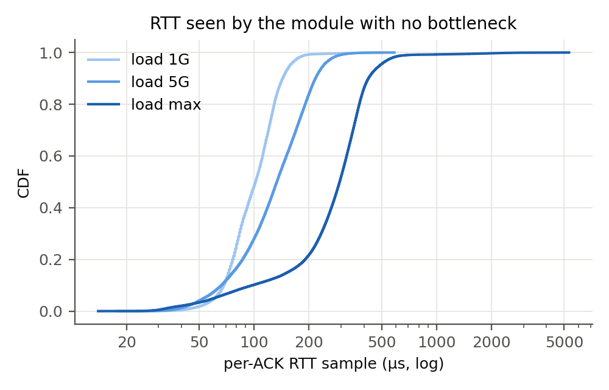
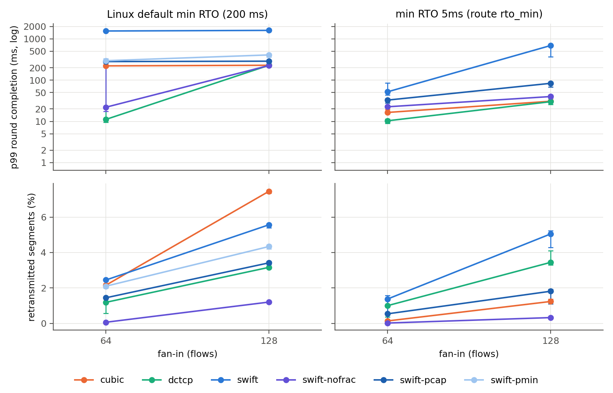
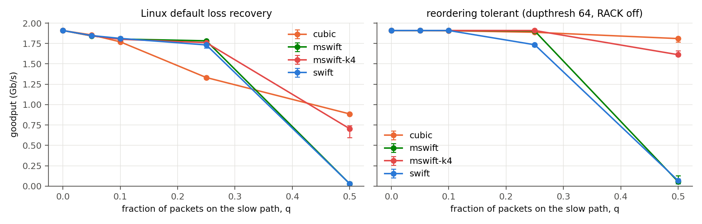

# GSwifT: Progress Report 2

**Delay-Based Congestion Control on Commodity Linux**

Ethan Kim, Gregory Park, Niki Hu, Xiaomeng Ye, Raymond Zhao
GitHub: https://github.com/Niki2357/GswifT.git (branch `progress2-impl`)

## Summary of progress since Report 1

- **Swift runs in the Linux kernel.** We implemented Swift's Algorithm 1 as a
  BPF `struct_ops` TCP congestion control (`src/swift.bpf.c`) with fractional
  windows below one packet and MSwift's median filter and reordering
  tolerance. It loads on stock Ubuntu kernels (6.8) with no kernel changes.
- **Full measurement pipeline.** A loader with per-ACK telemetry, a
  synchronized incast generator that doubles as an RPC latency probe, an
  emulated bottleneck with a fixed buffer, packet-spraying emulation, and an
  analysis package that produces every table and figure here, including
  medians and ranges over repeated runs.
- **Two evaluation sessions on two hardware types.** Nov 9: 2 x c6525-25g (AMD
  EPYC, ConnectX-5), every configuration once. Nov 10: 2 x xl170 (Intel Xeon,
  ConnectX-4 Lx), the key configurations repeated 3-5 times, a redesigned
  MSwift experiment, a packet-level diagnosis of the fractional-window
  failure, and a fix for it. About 350 runs in total.
- **Seven implementation findings** about running Swift inside Linux that the
  Swift paper does not surface (Section 4.4).

**Headline results**

1. **One flow: Swift works as designed on both machines.** On the xl170
   nodes it reaches 95% of a 10 Gb/s bottleneck with the lowest p99 queue
   (56 µs) of the three algorithms we repeated, and p99 RPC latency (237 µs)
   on par with DCTCP and well below Cubic (340 µs).
2. **Host delay sets a floor on the target, and near that floor Swift is
   unstable (RQ1).** With 8 flows and a 100 µs target, Swift filled 89-93%
   of the link at 11:00 and 35-47% at 13:30 on the same nodes, while
   Cubic and DCTCP barely changed. The only difference was a roughly 10 µs
   rise in the tail of host delay. A 200 µs target held 91-96% in both
   periods. Targets below 100 µs failed in every run in both sessions
   (0-38% utilization).
3. **Swift's incast advantage is loss avoidance, and its size depends on
   Linux's 200 ms minimum RTO (RQ3).** At 64 senders, Swift with a one-packet
   window floor retransmits 0.06% of segments versus 1.2-2.2% for Cubic and
   DCTCP, and finishes rounds 10x faster than Cubic (22 ms versus 222 ms p99)
   on both machines. DCTCP with ECN was faster still on the xl170 nodes
   (11 ms). With the minimum RTO lowered to 5 ms, Cubic and DCTCP recover
   quickly from loss and finish incast rounds faster than Swift.
4. **We found why fractional windows hurt incast on Linux.** Below one
   packet, Linux keeps a single packet in flight. When it is dropped, nothing
   triggers fast retransmit, and Linux's tail-loss probe for a lone packet
   waits the minimum RTO (200 ms). Pacing from the minimum RTT with a capped
   gap cut the p99 round time 5.5x (1.55 s to 0.28 s), and adding a 5 ms
   minimum RTO cut it to 33 ms. It is still slower than a one-packet floor.
5. **MSwift's median filter works once Linux stops treating reordering as
   loss.** With Linux's default loss detection, sprayed reordering triggers
   70,000-260,000 fast recoveries per run (q = 0.05-0.25) and hides the
   effect. With RACK off
   and a reordering threshold of 64, MSwift keeps 1.90 Gb/s (of 2) at q = 0.25
   where Swift drops to 1.73, and MSwift with reordering tolerance k = 4 keeps
   1.61 Gb/s at q = 0.5 where Swift collapses to 0.07.

## 1. Problem Definition

Unchanged from Report 1. Swift (Kumar et al., SIGCOMM 2020) holds end-to-end
delay near a target with AIMD on the congestion window. Google's deployment
relies on NIC timestamps, an OS-bypass transport, and fine-grained pacing. We
ask how much of Swift's benefit survives in stock Linux TCP, implemented as an
eBPF congestion control module:

- **RQ1 (measurement):** Is software-timestamped RTT accurate enough to drive
  Swift's control loop?
- **RQ2 (fabric vs endpoint):** Can a Linux sender separate network congestion
  from receiver congestion? (Deferred to the final report; see Section 7.)
- **RQ3 (incast):** Do pacing-based fractional windows handle large fan-in
  better than Cubic and DCTCP?
- **Extension:** Does MSwift's median filter keep Swift's throughput when a
  fraction q of packets takes a slower path?

## 2. Motivation

Delay is a simple congestion signal that needs no switch support. At Google,
Swift kept tail latency low at high utilization. A version that runs on stock
Linux would make that available to any operator, not only those with custom
transport stacks.

Report 1 showed that on an idle path almost all of an application's RTT is
host software, not network. Our sessions add the loaded case: with no network
bottleneck at all, the median RTT sample our module receives grows from about
100 µs at 1 Gb/s to about 300 µs as one flow speeds up (Section 6.1). A
delay-based controller that reads these samples sees queuing that the network
did not cause, and Section 6.3 shows this is what limits how low Swift's
target can go and how stable it is there.

## 3. Challenges

Report 1 listed the expected difficulties. Building and running the module
turned several of them into concrete constraints:

- **Host delay grows with load and drifts over time.** The RTT a congestion
  control module sees includes queuing in both hosts' stacks. It grows with
  throughput even when the network is idle (Section 6.1), and its tail moved
  enough within one session to halve Swift's throughput (Section 6.3).
- **Kernel version is a hard requirement.** Kernels before 6.0 reject BPF
  writes to `sk_pacing_rate` and `sk_pacing_status` from a congestion control,
  and without pacing a sender cannot go below one packet per RTT.
- **Verifier budget.** Flow-based target scaling needs `1/sqrt(cwnd)` per ACK.
  Our integer square root exceeded the verifier's one-million-instruction
  budget even after we made it branch-free and fully unrolled.
- **Linux's loss recovery acts before Swift does.** Fast recovery on
  reordering (Section 6.5) and timer-driven recovery of a lone packet
  (Section 6.4) both cut or stall the window independently of the delay
  signal.
- **Creating congestion.** Two nodes share no switch bottleneck, so we build
  it explicitly on the receiver (Section 4.3).
- **Testbed availability.** We could not get the same node type twice. Each
  session records its own environment and baseline, and we compare
  algorithms within a session, not across sessions.

## 4. Methodology (implemented)

### 4.1 Testbeds

| | Session 1 (Nov 9) | Session 2 (Nov 10) |
|---|---|---|
| Nodes | 2 x c6525-25g, AMD EPYC 7302P (16 cores) | 2 x xl170, Intel Xeon E5-2640 v4 (10 cores) |
| NIC | ConnectX-5, 25 GbE | ConnectX-4 Lx, 25 GbE |
| OS / kernel | Ubuntu 22.04, HWE kernel 6.8.0-138 | Ubuntu 20.04, mainline kernel 6.8.0 |
| Unloaded 64 B TCP RTT (p1 / p50 / p99) | 40.7 / 42.2 / 55.3 µs | 35.3 / 38.5 / 53.9 µs |
| Repeats | each configuration once | 3-5 per configuration |

Both: MTU 1500, NIC receive timestamp filter `all`, interrupt coalescing off,
quick ACKs on the experiment route, `tcp_slow_start_after_idle=0`. Neither
exposes a `performance` CPU frequency governor (session 2 ran `ondemand`).
Session 2 is the primary source of results in this report because of its
repeats; session 1 numbers are given where they add a second machine.

### 4.2 The Swift module

The algorithm is a single C header (`src/swift_core.h`) of pure functions
over a per-socket state struct. The same file compiles into the BPF module
and into a userspace unit-test binary (100,078 checks, run on every build).
`src/swift.bpf.c` adapts it to Linux:

| Swift mechanism | Linux implementation |
|---|---|
| Delay signal | `rate_sample.rtt_us` on every ACK in `cong_control` |
| Target | `base + hops x h`; per-destination hop count from a BPF map |
| Additive increase | `cwnd += ai x acked / cwnd` (or `ai x acked` below 1) when delay < target |
| Multiplicative decrease | `cwnd x max(1 - β(delay - target)/delay, 1 - max_mdf)`, at most once per smoothed RTT |
| Fractional cwnd | Q16 fixed point in module state; Linux gets `snd_cwnd = max(1, floor(cwnd))` |
| cwnd < 1 | `sk_pacing_rate = mss x cwnd / RTT` with TCP internal pacing. RTT is the smoothed RTT, or optionally the minimum RTT (`--pace-min-rtt`); optional cap on the gap between packets (`--max-pace-gap`) |
| Retransmission timeout | `cwnd_event(CA_EVENT_LOSS)`: decrease, or reset to `min_cwnd` after 3 in a row |
| Fast recovery | `set_state(TCP_CA_Recovery)`: decrease by `max_mdf`, once per RTT |
| MSwift median | median of the last `min(cwnd/2, 16)` samples (16-entry ring of 16-bit samples) |
| MSwift reordering tolerance | decrease only after k consecutive over-target samples |

Per-socket state is 72 bytes, within the 104 bytes Linux reserves for a
congestion control. Default parameters: base target 100 µs, `ai` = 1,
β = 0.8, `max_mdf` = 0.5, `min_cwnd` = 0.01, initial cwnd 10.

**Variants used below.** `swift`: defaults. `swift-nofrac`: `min_cwnd` = 1, so
no fractional windows. `swift-pmin`: sub-packet pacing from the minimum RTT.
`swift-pcap`: as `swift-pmin`, plus at least one packet per 1 ms. `mswift`:
median filter of 16. `mswift-k4`: median filter plus k = 4.

**Telemetry.** Each ACK (or every Nth) emits a 64-byte record (time, RTT
sample, delay used, target, cwnd, `snd_cwnd`, pacing rate, packets in
flight) through a BPF ring buffer. `swiftctl` loads the module, writes the
parameters, streams records to CSV, and dumps counters at exit.

**Validation on the nodes** (`scripts/smoke_test.sh`, all checks pass in both
sessions; session 2 values shown):

| Check | Result |
|---|---|
| Module loads and carries traffic | 18.1 Gb/s single flow; 265,894 RTT samples in 271,878 ACKs |
| cwnd pinned at 0.5 packet | `snd_cwnd` stays 1; achieved rate 0.95x the target `mss x cwnd / srtt` |
| Bottleneck enforces its rate | 4 Cubic flows: 9.5 Gb/s through a 10 Gb/s limit |
| Incast tool | 20 rounds of 16 x 64 KB complete |
| Spraying marks the intended fraction | checked per run from qdisc byte counters (Section 6.5) |

### 4.3 Experimental setup

**Bottleneck.** All traffic arriving at the receiver is redirected through an
IFB device, rate-limited by HTB (10 Gb/s; 2 Gb/s for spraying), and queued in
a single FIFO of 300 packets (100 packets for incast, about 120 µs at
10 Gb/s). The FIFO is `fq_codel` with one flow queue, CoDel's drop law
disabled, and `drop_batch 1`, so a full queue drops one packet at a time.
Packets queued longer than 50 µs are CE-marked if ECN-capable, which affects
only DCTCP. The queue's backlog, sampled every 10 ms, gives ground-truth
queuing delay.

**Traffic.** iperf3 for bulk flows. A 64-byte request/response probe runs
alongside every bulk run, and its responses cross the bottleneck, so it
measures RPC latency under load. Our incast tool opens N connections and
asks all of them for 64 KB at the same moment, 100 rounds per run, recording
each flow's completion time.

**Spraying.** On the sender, iptables' `statistic` match marks data packets
with probability q. Marked packets go through a netem class adding 300 µs,
standing in for a congested path. TSO/GSO are disabled. We verify the split
from the netem and root qdisc byte counters; in session 2 every algorithm got
the intended share (0.050, 0.100 and 0.249 for q = 0.05, 0.1, 0.25). Marking
happens before Linux splits packets to wire size, so slow-path packets come
in short bursts of about 1.5-2.5 segments rather than one at a time.

**Repeats.** `REPS=N` runs each experiment's whole sweep N times, with the
repeat loop outermost so repeats of one configuration are spread over the
session. Tables report the median with min-max in parentheses; figures draw
min-max bars. With 3-5 samples we report the range rather than a standard
deviation.

### 4.4 Implementation findings

1. **Sub-packet windows need kernel 6.0+.** Kernel 5.15's verifier rejects
   BPF writes to the pacing fields. Session 2's image only offered up to
   5.15, so we installed a mainline 6.8 kernel (its zstd-compressed modules
   had to be decompressed for Ubuntu 20.04's module loader).
2. **Flow scaling does not fit the verifier budget yet.** Computing
   `1/sqrt(cwnd)` per ACK exceeded one million verifier steps. Flow scaling is
   compiled out of the BPF build for now (it remains in the unit-tested
   core). Planned fix: a lookup table indexed by cwnd bucket.
3. **Pacing below one packet ran 1.8x fast.** With cwnd pinned at 0.5, the
   achieved rate was 1.8x `mss x cwnd / srtt` on session 1's nodes. Halving
   the requested rate below one packet gives 0.89-0.98x on both machines.
   Our hypothesis is internal pacing's jitter credit
   (`tcp_update_skb_after_send`); the root cause is unconfirmed.
4. **A lone packet in flight costs 200 ms when lost.** Linux's tail-loss
   probe adds the minimum RTO when exactly one packet is outstanding (to
   allow for a delayed ACK). Sub-packet windows always have one packet
   outstanding, so every drop costs about 200 ms (Section 6.4). The minimum
   RTO can be lowered per route (`rto_min`).
5. **Linux loss recovery must be made reordering tolerant for MSwift.**
   Sprayed reordering makes Linux enter fast recovery, and our module, like
   Swift, cuts on recovery. RACK off and `tcp_reordering = 64` removes these
   cuts (Section 6.5).
6. **Applications cannot opt in by default.** Unprivileged sockets may only
   select algorithms listed in `net.ipv4.tcp_allowed_congestion_control`. A
   deployment must add Swift there.
7. **Quick ACKs remain essential.** As in Report 1, delayed ACKs stall a
   one-packet window; all runs set `quickack` on the experiment route.

## 5. Related Work

**Swift** (Kumar et al., SIGCOMM 2020) is the design we reproduce: target-delay
AIMD, a fabric/endpoint delay split, cwnd below 1 with pacing, and topology-
and flow-scaled targets, deployed on Pony Express with NIC timestamps. We
implement it inside standard Linux TCP without OS bypass or NIC timestamps in
the loop, and measure which properties survive.

**MSwift** (Gerstein, Silberstein, Keslassy, arXiv 2025) shows that when a
fraction q of sprayed packets hits a congested path, Swift's throughput falls
roughly as 1/sqrt(q), and fixes it with a median filter and reordering
tolerance. We test the fix on a real Linux stack, where Linux's own
reordering detection interacts with it.

**Falcon** (Singhvi et al., SIGCOMM 2025) is Google's hardware transport, with
a two-window (fabric and NIC) Swift variant and hardware timestamps and
pacing. It marks the opposite end of the design space from our
software-only implementation.

**Baselines:** Cubic (Linux default, loss-based), DCTCP (ECN-based), Vegas
(classic delay-based), BBR (model-based). Session 2 repeats Cubic and DCTCP;
Vegas and BBR appear in session 1 only.

## 6. Evaluation

Raw data, per-run metadata, session logs and the scripts behind every number
are in `results/2026-11-09/` and `results/2026-11-10/`;
`python3 -m analysis.analyze results/<date>` regenerates each session's
tables and figures. Unless marked otherwise, numbers are from session 2 and
given as median (min-max) over the stated number of repeats.

### 6.1 E0: what the module's RTT samples contain (RQ1)

No bottleneck: one Swift flow with an unreachable target (so it never backs
off), at three offered loads. Any RTT above the unloaded floor is host
queuing, not network queuing. One run per load.

| Offered load | Goodput | RTT samples | min | p50 | p99 | p99.9 | Session 1 p50 |
|---|---|---|---|---|---|---|---|
| 1 Gb/s | 1.0 Gb/s | 41,673 | 23 µs | 102 µs | 191 µs | 381 µs | 56 µs |
| 5 Gb/s | 5.0 Gb/s | 134,939 | 18 µs | 133 µs | 294 µs | 398 µs | 118 µs |
| unlimited | 18.0 Gb/s | 380,596 | 14 µs | 294 µs | 685 µs | 2,600 µs | 340 µs |

**Analysis.** On both machines the module's median RTT sample grows 3-6x
from 1 Gb/s to an unlimited flow while the network stays idle, reaching
about 300 µs, roughly 8x the unloaded 64 B RTT. The growth comes from data
queued in the sender's stack and NIC and from receive processing, which a
sender's RTT sample cannot separate from network queuing. The xl170 nodes
are noisier at low load (p50 102 µs versus 56 µs at 1 Gb/s), and the tail at
full speed is long (p99.9 2.6 ms). This sets the scale for the rest of the
evaluation: a fixed target of 100 µs sits inside the host-delay distribution
at every load.

### 6.2 E1: Swift against Cubic and DCTCP

10 Gb/s bottleneck, 300-packet buffer, 20 s per run, 64 B RPC probe running
throughout, 5 repeats.

| Algorithm | Flows | Goodput (Gb/s) | Queue p99 (µs) | RPC p99 (µs) |
|---|---|---|---|---|
| Swift | 1 | 9.51 (9.51-9.51) | 56 (55-57) | 237 (210-251) |
| DCTCP | 1 | 9.55 (9.55-9.55) | 70 (69-71) | 249 (233-263) |
| Cubic | 1 | 9.34 (9.33-9.35) | 164 (133-164) | 340 (334-348) |
| Swift | 8 | 9.15 (8.94-9.29) | 84 (78-89) | 246 (237-335) |
| DCTCP | 8 | 9.51 (9.51-9.53) | 133 (126-144) | 287 (263-403) |
| Cubic | 8 | 9.06 (8.93-9.10) | 119 (112-126) | 259 (254-318) |

**Analysis.**

- **Swift keeps the shallowest queue at full throughput.** With one flow
  Swift matches DCTCP's throughput with a 20% lower p99 queue and a third of
  Cubic's. With 8 flows its p99 queue (84 µs) is 30-40% below Cubic's and
  DCTCP's while delivering 91.5% of the link. Its RPC tail latency is on par
  with DCTCP and better than Cubic for one flow; at 8 flows the ranges of all
  three overlap.
- **Session 1 disagreed at 8 flows, and Section 6.3 explains why.** On
  session 1's nodes, Swift reached only 22%, 53% and 35% in three runs, and
  Cubic 52%. On session 2's nodes Swift reached 89-93% in all five repeats
  run at 11:05. Run again at 13:35, it reached only 35-47% (Section 6.3).
  The 8-flow, 100 µs operating point is not a stable property of Swift on
  Linux; it depends on the host-delay tail at the time.
- **Session 1 adds the other baselines (one run each).** With one flow, BBR
  held a standing queue (p99 327 µs) that tripled RPC tail latency, and
  Vegas kept the queue empty but lost 18% of throughput. At 8 flows Vegas
  also under-utilized (37%).

### 6.3 E2: how low can the target go, and how stable is it? (RQ1)

Swift with 8 flows, base target swept. "Module RTT" is the delay Swift reacts
to; "queue" is the bottleneck's true queuing delay. Two blocks of runs: the
main sweep at 11:19 (5 repeats), and a sweep run two hours later (13:25-13:39,
3 repeats, with 100, 150 and 200 µs interleaved).

| Target (µs) | Utilization, 11:19 | Utilization, 13:25-13:39 | Module RTT p50 / p99 (µs), later block | Queue p50 / p99 (µs), later block |
|---|---|---|---|---|
| 25 | | 0.1% | 102 / 137 | 0 / 0 |
| 50 | | 26% (26-27) | 46 / 103 | 0 / 0 |
| 75 | | 38% (37-40) | 69 / 146 | 0 / 2 |
| 100 | **92%** (90-93) | **43%** (40-43) | 94 / 173 | 0 / 6 |
| 150 | | 73% (69-79)* | 132 / 229 | 0 / 73 |
| 200 | 95.5% (95.4-95.5) | 91% (91-93) | 166 / 291 | 0 / 106 |
| 300 | 95.6% (95.5-95.6) | | | |

\*A non-interleaved run of 150 µs at 13:25 gave 67% (65-72). The E1 recheck
at 13:35 (3 repeats, interleaved): Swift 35-47%, Cubic 85-86%, DCTCP 95%.

**Analysis.**

- **Below 100 µs Swift cannot fill the link** (0-38% here; 0.1-15% in
  session 1). The
  module's median RTT sits just under each target with an empty network
  queue: it is regulating host delay, not network delay.
- **At 100 µs Swift is bistable.** The same configuration gave 90-93% in
  every repeat at 11:19 and 40-43% in every repeat at 13:30, with no setting
  changed (we checked sysctls, offloads, qdiscs, routes and firewall rules on
  both nodes). What changed is the host: Swift's RTT p99 rose from 161 µs to
  171-174 µs, and every algorithm's RPC p99 grew (Cubic's from 259 to about
  450 µs). That 10 µs shift halved Swift's throughput while Cubic lost 5
  points and DCTCP none. Swift decreases on any over-target sample, at most
  once per RTT, so when the target sits near the tail of host delay, a small
  change in that tail changes how often it backs off by a large factor.
  Session 1's 22-53% at the same setting is the same effect.
- **A target with margin above the host-delay tail is robust.** 200 µs gave
  95.5% in the first block and 91-93% in the noisier one. The cost is queue:
  at 200 µs the true queue p50 was 147 µs in the first block.
- **The host's share of the module's RTT is 10-20 µs above the floor here.**
  In the first block, module RTT p50 exceeds true queue p50 by 45 µs (200 µs
  target) and 52 µs (300 µs); subtracting the 35 µs unloaded floor leaves 10
  and 17 µs. Session 1 measured 33-37 µs the same way.

### 6.4 E3: incast (RQ3)

N flows each send 64 KB to the receiver at the same instant, 100 rounds,
100-packet buffer. A round cannot finish faster than N x 64 KB / 10 Gb/s
(3.4 ms at N = 64, 6.7 ms at N = 128). We ran each configuration with Linux's
default 200 ms minimum RTO and with `rto_min 5ms` on the sender's route,
which applies to every algorithm.

**p99 round completion time (ms)**, median (min-max); 5 repeats with the
default RTO (3 for DCTCP), 3 with `rto_min 5ms`:

| Variant | N = 64 | N = 128 | N = 64, rto_min 5 ms | N = 128, rto_min 5 ms |
|---|---|---|---|---|
| Cubic | 222 (221-222) | 229 (229-229) | 16.5 (16.0-19.4) | 30.8 (28.5-31.0) |
| DCTCP | 11.2 (9.4-207) | 229 (226-230) | 10.3 (9.0-11.5) | 30.0 (25.7-31.0) |
| Swift, one-packet floor | 22.0 (17.7-207) | 227 (226-227) | 22.6 (22.5-23.5) | 40.0 (36.7-43.7) |
| Swift (fractional) | 1,553 (1,538-1,587) | 1,606 (1,604-1,612) | 52 (44-86) | 689 (368-690) |
| + pace from min RTT | 296 (213-330) | 408 (364-432) | | |
| + gap cap 1 ms | 282 (263-291) | 288 (285-299) | 32.8 (28.2-35.4) | 83.7 (68.9-90.4) |

Retransmitted segments at N = 64, default RTO: Swift with a floor 0.06%,
DCTCP 1.2%, Cubic 2.2%, fractional variants 1.4-2.4%. Drops at the
bottleneck: 81, 1,298, 6,733 and 3,300-4,600 respectively.

**Analysis.**

- **Swift's advantage is that it barely loses packets.** With a one-packet
  floor it drops 16-83x fewer packets than DCTCP and Cubic at N = 64. Under
  Linux's default RTO, each loss Cubic cannot repair with fast retransmit
  costs 200 ms, so Swift finishes 10x faster than Cubic (22 versus 222 ms),
  matching session 1 (23 versus 223 ms).
- **DCTCP did better than in session 1.** On the xl170 nodes DCTCP finished
  N = 64 in 11 ms at p99, half of Swift's time, with no timeouts. In session 1
  it took 223 ms with 328 timeouts, like Cubic. We have not found the cause.
- **At N = 128 every algorithm hits the 200 ms RTO** under default settings,
  so Swift's session 1 advantage at large N (1.6-2.8x at p99) did not
  reproduce here.
- **Lowering the minimum RTO removes most of the gap.** With `rto_min 5ms`,
  Cubic and DCTCP recover from loss in milliseconds and finish faster than
  Swift (10-17 versus 23 ms at N = 64; 30-31 versus 40 ms at N = 128), while
  Swift still retransmits least (0.02% versus 0.14-1.0% at N = 64). Even
  without loss, Swift takes about 6x the line-rate bound at N = 64; we have
  not yet measured where that time goes.

**Why fractional windows hurt: packet-level diagnosis (E6).** We reran
`swift-pcap` and `swift-nofrac` at N = 64 for 20 rounds with every ACK traced
and a packet capture on the sender. With the gap cap, 43 flows took over
100 ms; with the floor, none did. Every one of the 31 in-burst send gaps we
found lasted 202-210 ms and followed the same sequence:

1. The flow, below one packet, sends one segment at a time and waits for its
   ACK (54% of this run's ACKs arrived with cwnd below 1).
2. A segment is dropped at the full bottleneck queue.
3. With no other packet in flight, no duplicate ACKs or SACKs arrive.
4. About 200 ms later Linux sends a tail-loss probe. The receiver's SACK of
   the probe exposes the hole, and the lost segment is retransmitted within
   1 ms.

Linux's probe timeout adds the minimum RTO when exactly one packet is
outstanding, to allow for a delayed ACK. None of these count as
retransmission timeouts, which is why the fractional runs showed almost no
timeouts (one 100-round run had 0 timeouts and 1,151 loss probes). This explains the 200 ms rounds
and why the floor avoids them: with several packets in flight a loss is
repaired by fast retransmit. It also explains why lowering the minimum RTO
helps the fractional variants most (282 to 33 ms).

The pacing changes address a second, separate problem. Pacing from the
smoothed RTT, which grows with queuing during incast, stretched sub-packet
gaps far beyond what the window intends (p99 1.55 s). Pacing from the
minimum RTT and capping the gap at 1 ms cut the p99 to 282 ms, and
retransmissions from 2.4% to 1.4%. Fractional windows still drop 40x more
packets than the floor (3,284 versus 81 at N = 64), so even with both fixes
they are slower. Most of their flows are fast, though: in one run the
median flow completed in 12.7 ms versus 14.5 ms with the floor.

### 6.5 E4: spraying and MSwift

A fraction q of data packets takes a path with 300 µs of extra delay; 8
flows; 2 Gb/s bottleneck (session 1's 10 Gb/s left the sender CPU-bound once
TSO was off; all algorithms now reach 1.91 Gb/s at q = 0). Three repeats.
We ran the sweep twice: with Linux's default loss detection, and with RACK
off and a duplicate-ACK threshold of 64 so Linux tolerates reordering.

**Goodput (Gb/s), median (min-max).** Default loss detection:

| q | Swift | MSwift | MSwift, k = 4 | Cubic |
|---|---|---|---|---|
| 0.05 | 1.85 (1.85-1.85) | 1.84 (1.84-1.84) | 1.84 (1.84-1.84) | 1.86 (1.85-1.86) |
| 0.10 | 1.81 (1.81-1.81) | 1.80 (1.80-1.81) | 1.80 (1.80-1.80) | 1.77 (1.76-1.83) |
| 0.25 | 1.73 (1.69-1.73) | 1.78 (1.78-1.79) | 1.76 (1.76-1.76) | 1.33 (1.31-1.34) |
| 0.50 | 0.03 (0.01-0.05) | 0.03 (0.03-0.05) | 0.70 (0.60-0.74) | 0.89 (0.88-0.89) |

Reordering tolerant (RACK off, `tcp_reordering = 64`):

| q | Swift | MSwift | MSwift, k = 4 | Cubic |
|---|---|---|---|---|
| 0.05 | 1.91 (1.91-1.91) | 1.91 (1.91-1.91) | 1.91 (1.91-1.91) | 1.91 (1.91-1.91) |
| 0.10 | 1.91 (1.91-1.91) | 1.91 (1.91-1.91) | 1.91 (1.91-1.91) | 1.91 (1.91-1.91) |
| 0.25 | **1.73** (1.71-1.74) | **1.90** (1.90-1.91) | **1.91** (1.91-1.91) | 1.89 (1.89-1.89) |
| 0.50 | 0.07 (0.03-0.09) | 0.05 (0.03-0.13) | **1.61** (1.60-1.66) | 1.81 (1.77-1.81) |

Fast recoveries per run, default loss detection: 70,000-260,000 for every
algorithm at q = 0.05-0.25 (fewer at q = 0.5, where Swift and MSwift barely
send). Reordering tolerant: 0-33.

**Analysis.**

- **With Linux's default loss detection, Linux's reaction to reordering is
  the dominant effect.** Every algorithm enters fast recovery tens of
  thousands of times per run, our module cuts cwnd on each, and the
  differences between Swift and MSwift are a few percent up to q = 0.25.
- **With reordering tolerated, the median filter does what MSwift
  predicts.** Fast recoveries drop to almost zero and everything holds the
  full 1.91 Gb/s up to q = 0.1. At q = 0.25, Swift loses 10% of throughput
  reacting to slow-path samples, while MSwift's median filter keeps 1.90.
- **At q = 0.5 the median alone cannot help, but reordering tolerance can.**
  With half the samples on the slow path, the median itself is a slow
  sample, and Swift and MSwift both collapse. Requiring 4 consecutive
  over-target samples before decreasing (k = 4) keeps 1.61 Gb/s, 84% of the
  link.
- **We did not see the 1/sqrt(q) decline** MSwift's analysis predicts for
  baseline Swift at small q: Swift held full throughput up to q = 0.1. Our
  slow path adds 300 µs, three times the target, so every slow sample
  exceeds the target; MSwift's model assumes per-packet independence, and our
  slow-path packets arrive in short bursts (Section 4.3). We have not yet
  separated these factors.

### 6.6 Session 1 diagnostic at 8 flows (E5)

In session 1, a repeat of Swift at 8 flows with full tracing gave 35% (22%
and 53% in other runs). Without fractional windows it gave 39%, so
sub-packet starvation was not the cause, and the delay signal's p99
(161-182 µs) sat well above the 100 µs target in every run. Session 2's
recheck (Section 6.3) confirms the interpretation with repeats: the outcome
at a 100 µs target is set by the host-delay tail at the time of the run.

## 7. Next Steps

**Done since Report 1:**
- the Swift module with fractional windows, MSwift's median filter and
  reordering tolerance, and two sub-packet pacing options;
- telemetry, the incast tool, the bottleneck, the spraying emulation, and an
  analysis pipeline with repeat statistics;
- two evaluation sessions on two hardware types, the second with repeats;
- a packet-level diagnosis of the fractional-window failure.

**Next, in priority order:**

1. **Make the target track host delay (RQ1).** A fixed target is either too
   low (unstable, Section 6.3) or wastes queue. Set it relative to a
   measured floor, for example a windowed low percentile of the RTT
   samples, and test whether this keeps Swift stable across the two host
   states we observed.
2. **Separate host delay from network delay (RQ2).** Carry the receiver's
   own queuing time back to the sender (a TCP option or timestamps), the
   fabric/endpoint split Swift relies on.
3. **Fix lone-packet recovery for fractional windows (RQ3).** Lower the
   minimum RTO from inside the module (`bpf_setsockopt(TCP_BPF_RTO_MIN)`)
   instead of per route, and keep two packets in flight while paced below
   one packet per RTT so that a loss can trigger fast retransmit.
4. **Test MSwift against its model.** Spray per wire packet (a tc-BPF egress
   program after segmentation), sweep the slow-path delay relative to the
   target, and compare Swift's decline with 1/sqrt(q).
5. **Flow-based target scaling.** Replace the per-ACK square root with a
   lookup table so it fits the verifier budget, then test fairness among
   many flows.
6. **Real multi-node incast and hardware timestamps.** Senders on separate
   machines through the cluster switch, and the Report 1 `SO_TIMESTAMPING`
   harness alongside the module to measure the error of software RTT
   directly.
